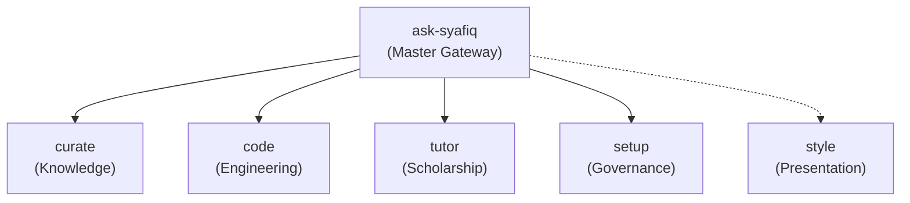

# Syafiq Kay Skills (`skay93m/skills`)

Personal skills, deep modules, and governance architecture for multi-agent workflows across Claude Code, Codex, Antigravity, and Hermes.

[](https://github.com/skay93m/skills/releases)
[](https://github.com/skay93m/skills/actions)
[](https://github.com/skay93m/skills/actions)

## Operator Quickstart

Get started with the skills ecosystem in three steps:

1. **Install the skills suite**:
   ```bash
   npx skills add skay93m/skills
   ```
   *To install a single deep module instead, specify `--skill <name>` (for example: `npx skills add skay93m/skills --skill style`).*

2. **Start any session with the master gateway**:
   Invoke `/ask-syafiq` in your agent prompt:
   > *"What workspace am I in, and how should we structure this session?"*

3. **Follow guided routing**:
   The gateway detects repository context and dispatches to the specialised domain module.

## Operator Decision Matrix

When you have a specific goal, consult this matrix to select the right capability:

| Goal | Reach for | Role | Details |
| :--- | :--- | :--- | :--- |
| **Starting a session or orienting in a repo** | `ask-syafiq` | Master Gateway | See [`docs/specs/v1-production-readiness.md`](docs/specs/v1-production-readiness.md) |
| **Writing voice, British English, rubrics** | `style` | Presentation Domain | See [`skills/style/SKILL.md`](skills/style/SKILL.md) |
| **Compiled knowledge and wiki ingestion** | `curate` | Knowledge Domain | Delegates to [`basic-memory-skills`](docs/authorised-skill-repositories.md) |
| **Building code, TDD, reviews, and PRs** | `code` | Engineering Domain | Delegates to [`mattpocock/skills`](docs/authorised-skill-repositories.md) |
| **Postgraduate scholarship, Socratic sparring** | `tutor` | Scholarship Domain | See [`docs/specs/v1-production-readiness.md`](docs/specs/v1-production-readiness.md) |
| **Fleet governance, batch ceilings, golden sync** | `setup` | Governance Domain | See [`docs/agents/coordinator-protocol.md`](docs/agents/coordinator-protocol.md) |

## Architecture: The 4+1 Deep Module Model

The repository organises capabilities into a master gateway (`ask-syafiq`), four action domain deep modules (`curate`, `code`, `tutor`, `setup`), and one cross-cutting presentation module (`style`). Architectural decisions and rationale are codified in [`docs/adr/0002-four-domain-gateway-and-style-architecture.md`](docs/adr/0002-four-domain-gateway-and-style-architecture.md):



## Agile Sprint Framework and Operational Interfaces

Repository feature development, refactoring, and maintenance follow native GitHub Agile workflows documented across governing files:

- **Sprints**: Tracked as GitHub Milestones. See [`docs/agents/issue-tracker.md`](docs/agents/issue-tracker.md).
- **Dockets**: Deliberation packages prepared for human review and inline annotation in Obsidian. See [`docs/dockets/`](docs/dockets/) and [`GLOSSARY.md`](GLOSSARY.md).
- **Work Orders**: Authoritative operational directives packaging sprint tickets, sequential execution order, living execution ledgers, and confidential prune points. See [`docs/work-orders/`](docs/work-orders/) and [`GLOSSARY.md`](GLOSSARY.md).
- **Chief of Staff AFK Protocol**: Autonomous sprint execution with staged deterministic pre-checks, a three-pass review ceiling, isolated scope pruning, automated `git revert` rollback on `main`, and 429 rate-limit backoff. See [`docs/agents/coordinator-protocol.md`](docs/agents/coordinator-protocol.md).

## Multi-Agent Runtime Installation

Skills in this repository are packaged for instant installation across all major agent runtimes using `npx skills`:

```bash
# Install the complete suite
npx skills add skay93m/skills

# Install individual deep modules
npx skills add skay93m/skills --skill ask-syafiq
npx skills add skay93m/skills --skill style
```

Supported runtime directories and discovery mechanisms are detailed in [`docs/standards/skill-manifest.md`](docs/standards/skill-manifest.md).

## Safe Tombstone Policy

To protect backwards compatibility across existing agent sessions and prompts, 26 legacy utility skills (`sk-*` and `task-assistant`) are maintained as fail-closed safe tombstones with zero side effects. See [`docs/specs/v1-production-readiness.md`](docs/specs/v1-production-readiness.md).

## Developer and Contributor Guide

- **Standards and Invariants**: Governed by [`docs/standards/skill-manifest.md`](docs/standards/skill-manifest.md) and [`docs/standards/pr-review-standard.md`](docs/standards/pr-review-standard.md).
- **Style Rules**: British English spelling throughout, strictly zero em dashes, and strictly zero horizontal dividers in markdown bodies.
- **Verification Suite**:
  ```bash
  pytest
  python3 scripts/check-standard.py
  ```
  All pull requests require 0 test failures (`pytest`) and 0 blocking findings from `scripts/check-standard.py`. See [`docs/standards/automated-checks.md`](docs/standards/automated-checks.md).
