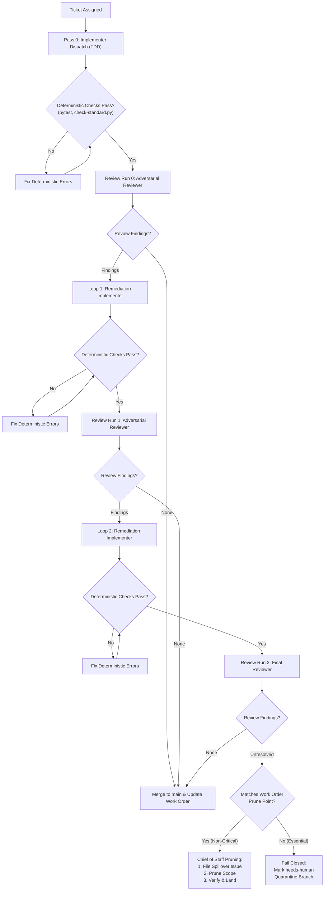

# Chief of Staff Sprint Execution Protocol

The Chief of Staff Sprint Execution Protocol provides an autonomous, unattended operational model for delivering complete sprint milestones. It packages sprint goals, ticket sequences, and acceptance criteria into a structured Work Order that a Chief of Staff coordinator agent executes Away From Keyboard (AFK), requiring zero interactive clarification during execution.

> [!IMPORTANT]
> **Core Invariant**: The Chief of Staff coordinator runs the entire sprint 100% AFK, requiring zero human input during execution.
> **Operational Guarantee**: Zero unreviewed code lands on main. Every ticket converges through deterministic checks and bounded review loops, with isolated prune points managed exclusively by the Chief of Staff.

## 1. Architectural Model: The Sprint as an Autonomous Delegation Unit

Rather than micromanaging individual prompt turns, sprints are planned in GitHub Milestones and executed via a dedicated Work Order (located at `docs/work-orders/wo-<no>.md`).

The Chief of Staff operates as the single autonomous project manager:
1. It reads the sprint milestone, tickets, and the active Work Order.
2. It coordinates sequential ticket implementation and reviews completely unattended.
3. It enforces deterministic static checks before spawning LLM reviewers.
4. It maintains a living execution ledger inside the Work Order, appending status updates, subagent runs, findings, and issues.
5. It handles post-merge CI verification and release tagging.

## 2. Sprint Sizing and Density Criteria

A sprint milestone must possess sufficient density to justify autonomous execution while remaining achievable within a single context session:
- **Ticket Density**: Between 3 and 7 well-specified tickets per sprint milestone.
- **Cohesive Theme**: All tickets in the sprint advance a unified milestone deliverable.
- **Finite Horizon**: Executable within a single continuous session (typically 2 to 4 hours of autonomous runtime).

## 3. Atomic Ticket Lifecycle: Pass 0 plus Two Remediation Loops

Every ticket follows a disciplined three-stage lifecycle with a maximum of three review runs (Pass 0 plus up to two remediation loops):

### Staged Verification Architecture
To eliminate computational and token waste, reviews are tiered:
- **Stage 1 (Deterministic Pre-Checks)**: The coordinator runs `pytest` and `python3 scripts/check-standard.py`. If any check exits with non-zero status, findings return immediately to the implementer. Zero LLM reviewers are spawned on broken code.
- **Stage 2 (Adversarial Review)**:
  - Standard tickets: Dispatches a single unified reviewer checking specification compliance and repository standards.
  - Core interface/protocol tickets: Dispatches dual reviewers (Spec and Architecture).
  - Codebase alignment: Evaluated once globally during sprint planning and once prior to merging the complete sprint into main, avoiding redundant subagents per loop.

### Iteration Boundaries
- **Pass 0**: Initial implementation and Review Run 0.
- **Loop 1**: First remediation and Review Run 1.
- **Loop 2**: Second remediation and Review Run 2.
- If findings persist after Review Run 2, the ticket halts.

## 4. Isolated Pruning Authority and Work Order Contract

To prevent gaming and moral hazards, pruning authority is strictly separated from subagents:
1. **Zero Context Contamination**: Implementers and reviewers receive only the pure GitHub ticket and specification. They have zero knowledge of prune points.
2. **Exclusive Authority**: Pre-configured prune points exist only in the Work Order (`docs/work-orders/wo-<no>.md`) and are visible only to the Chief of Staff.
3. **Execution Protocol on Loop 2 Failure**:
   - If unresolved findings match the explicit Work Order prune point: The Chief of Staff creates a new follow-up GitHub issue labeled `ready-for-agent` for the next sprint, prunes that specific non-critical requirement from the ticket, dispatches a final confirmation reviewer on the pruned scope, and merges.
   - If unresolved findings involve essential criteria (anything not pre-configured as a prune point): The Chief of Staff immediately fails closed. It reverts the worktree, labels the ticket `needs-human`, preserves the quarantine branch, and continues to the next independent ticket.

## 5. Main Branch Protection, Concurrency, and Circuit Breakers

### Strict Sequential Ticket Execution
Tickets execute sequentially on main: Ticket 1 implements, passes verification, lands on main, and then Ticket 2 commences. This completely avoids git index lock contention, worktree directory leaks, and headless semantic merge conflicts.

### Automated Rollback on Main
If the post-merge 5-point CI gate fails on main at the conclusion of a sprint:
1. The Chief of Staff immediately executes `git revert` on the merge commit of the offending ticket.
2. It re-runs the CI gate to verify that main returns to a clean green state.
3. It marks the offending ticket as `needs-human` and logs the incident to the Work Order.
4. Release tagging is aborted.

### Rate-Limit Circuit Breaker (HTTP 429)
If any subagent call encounters `RESOURCE_EXHAUSTED` (HTTP 429):
1. The Chief of Staff pauses execution using a 120-second schedule timer.
2. It serializes all downstream executions to a single flow.
3. It retries up to 3 times before halting the sprint and logging a failure notice to the Work Order.

## 6. Work Order Lifecycle and Living Ledger

Every sprint is governed by a Work Order file (`docs/work-orders/wo-<no>.md`):
- **Header**: Milestone, goal, sequential ticket list, and Chief-of-Staff-only prune points.
- **Living Ledger**: As each ticket runs, the Chief of Staff appends timestamps, subagent conversation IDs, review verdicts, and any issues directly into the Work Order.
- **Handoff**: On completion, the Work Order contains the complete, verifiable audit trail of the sprint.

## Observations
- [decision] Standardise loop cadence to Pass 0 plus up to 2 remediation loops (maximum 3 review runs) #governance
- [decision] Pre-configure non-critical prune points exclusively in Work Orders, hiding them from subagents #safety
- [decision] Evaluate codebase alignment at sprint planning and pre-merge, rather than per remediation loop #efficiency
- [decision] Execute sprint tickets sequentially on main to prevent git lock contention and semantic merge conflicts #git
- [decision] Mandate automated git revert rollback on main if release CI gate fails #reliability
- [decision] Enforce 120-second backoff and serialization circuit breaker on HTTP 429 quota exhaustion #resilience

## Relations
- implements [[Docket 1: Chief of Staff Sprint Execution Protocol Adversarial Review]]
- governs [[Work Order 1: Sprint 1]]
- defines [[GLOSSARY]]
