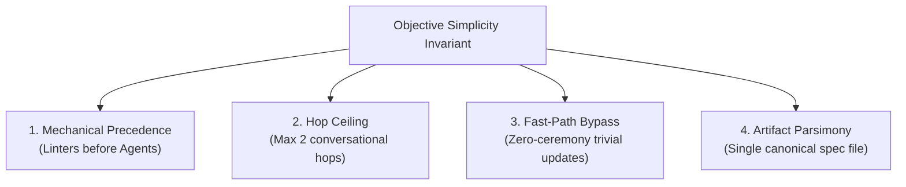

# Hardening the Simplicity Criterion

> [!IMPORTANT]
> **Context**: In [`docs/proposals/v1-production-tickets-plan.md`](docs/proposals/v1-production-tickets-plan.md), Ticket 1 includes the criterion:
> `Considered and applied the principle "prefer simple over complex processes"`
> **Problem**: As currently phrased, this is subjective and untestable. An agent or human cannot deterministically evaluate whether a process is "simple enough" without objective bounds.

---

## 1. Concrete Hardening Dimensions

To make "prefer simple over complex processes" testable and rigorous, we translate it into four operational constraints:



---

## 2. Hardening Candidates for Ticket 1

| Option | Hardened Operational Criteria | How an Agent Tests It |
| :--- | :--- | :--- |
| **Option A (Structural Bounds - Recommended)** | **The 3-Gate Simplicity Bound**: <br>1. *Mechanical Gate*: All line budgets, token counts, and frontmatter checks run via `check-standard.py` before any grilling or LLM review is triggered.<br>2. *Hop Ceiling*: Maximum 2 sequential review round-trips allowed before requiring either human decision or terminal rejection.<br>3. *Fast-Path Exemption*: Single-file edits, typos, or upstream pin bumps bypass the 3-stage funnel directly to a 1-step PR. | Automated tests check exit codes of linters and count prompt turns. |
| **Option B (Friction Budget Metric)** | **The Zero-Friction Metric**: <br>• Workflow complexity measured by total interaction turns: interactive deployment takes $\le 3$ human interactions.<br>• Requires no new YAML/config schema beyond the existing `SKILL.md` frontmatter.<br>• Automated review must complete in $< 60$ seconds. | Benchmarked via execution timer and interaction turn counter. |
| **Option C (Negative Invariants / Inversion)** | **Anti-Complexity Invariants (What the Process Forbids)**: <br>1. No intermediate draft notes outside `docs/specs/`.<br>2. No human approval required for automated lint checks.<br>3. No multi-agent consensus loops where agents review each other indefinitely. | Linting rules and protocol assertions. |

---

## 3. Recommended Before & After for Ticket 1

### Before (Subjective)
```markdown
- [ ] Considered and applied the principle "prefer simple over complex processes"
```

### After (Objective & Testable)
```markdown
- [ ] Simplicity Invariants Verified:
  1. Mechanical Precedence: Mechanical checks (tokens, line counts, provenance) must pass via deterministic CLI script before any conversational grilling or agent review begins.
  2. Turn Budget: The review loop strictly caps conversational turns at $\le 2$ iterations; if unresolved, it escalates to terminal owner decision.
  3. Fast-Path: Defines a 1-step bypass for trivial updates (typos, single-file doc fixes, upstream version bumps) that skip multi-stage grilling.
  4. Single Artifact: The workflow produces exactly one durable tracking document in `docs/specs/` without intermediate draft clutter.
```

---

## 4. Comparison Summary

- **Subjective Failure Mode**: An agent generates a 5-step bureaucratic committee review because it "considered" simplicity but concluded complexity was warranted.
- **Hardened Reality**: The agent is bound by a strict turn budget ($\le 2$ turns), a mechanical linter preflight, a fast-path exemption, and a single artifact rule.
