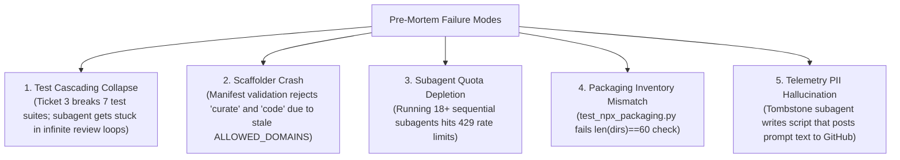
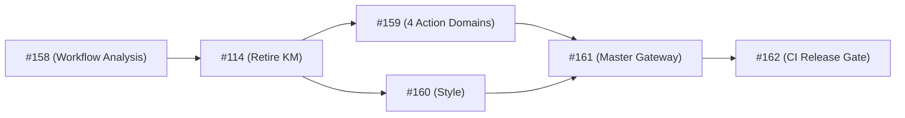
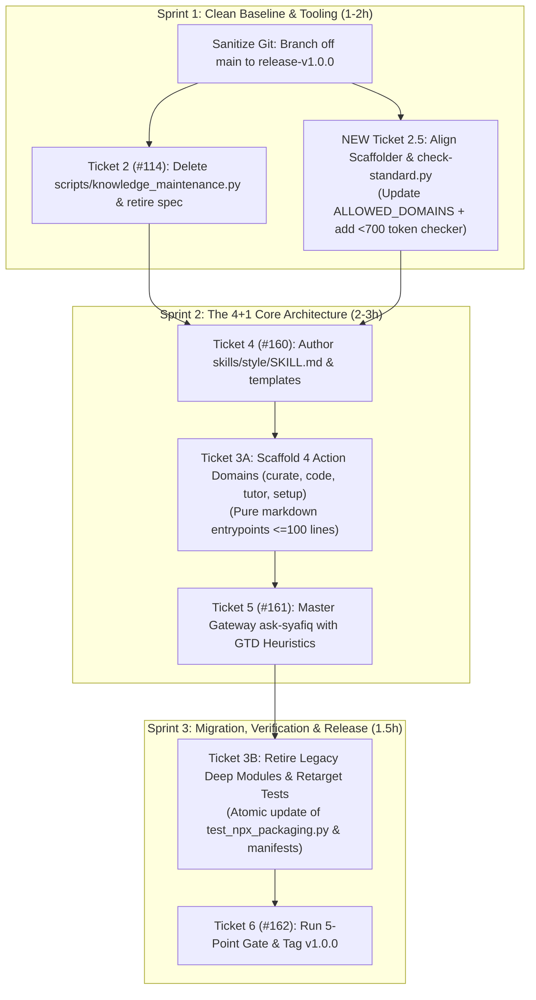

# Adversarial Milestone & Plan Review: Milestone 3 (v1.0.0)

> [!IMPORTANT]
> **Context & Mandate**: Rigorous, adversarial stress-test of Milestone 3 (*"v1.0.0: Minimal Production Deploy"*), evaluating whether the tickets and specifications are complete, sound, and realistically executable **TODAY** (2026-10-18) without hitting concurrency bottlenecks, rate limits, or context exhaustion.

---

## 1. Executive Summary & Verdict Table

| Assessment Dimension | Rating | Key Finding |
| :--- | :---: | :--- |
| **Feasibility Today** | **HIGH RISK / BLOCKED** | As currently scoped, Ticket 3 (#159) is an unmanageable megaticket with an unbudgeted test migration blast radius (>100 assertions). |
| **Completeness & Gap Analysis** | **GAPS IDENTIFIED** | Phase 1 of Spec #157 (scaffolder enum updates and token checker implementation) was omitted from ticket decomposition. |
| **Topological Consistency** | **CONTRADICTORY** | Contradiction between ADR 0002 ("strictly 6 root directories") and Section 7 of Spec #157 ("retaining 26 safe tombstones in skills/"). |
| **Process Friction (Via Negativa)** | **OVER-ENGINEERED** | Ticket 1 (#158: Future Ingestion Workflow) is artificially placed on the critical path, blocking Ticket 2 (#114). |
| **Critical Path & Deadlock** | **FRAGILE** | Monolithic linear dependency chain ($T1 \to T2 \to T3 \to T5 \to T6$) with no parallelization or contingency boundaries. |

---

## 2. Thinking-Partner Mental Model Interrogations

### 2.1 Feasibility & Time-Budget Analysis: Can this genuinely ship TODAY?

> [!WARNING]
> **Subagent Turn Exhaustion**: Executing 6 tickets through the mandatory Two-Axis Review Loop (1 Implementer + 2 Reviewers per ticket = 18 subagent turns minimum, expanding to 25+ with iteration loops) will saturate model rate limits and exceed single-day operator stamina if attempted sequentially.

1. **The Megaticket Trap (Ticket 3 - #159)**:
   - Scope currently demands:
     - Creating 4 new action domains (`curate`, `code`, `tutor`, `setup`).
     - Wiring upstream delegation contracts for `basic-memory-skills` and `mattpocock/skills`.
     - Refactoring `code-review` into three parallel subagents (Spec, Codebase, Standards).
     - Establishing `msc-coach` submodule interfaces.
   - **The Hidden Landmine**: What happens to the 6 existing deep modules (`wiki-ops`, `autonomous-scrum`, `agent-ecosystem`, `academic-scholar`, `personal-cadence`, `thinking-partner`)? Deleting or moving them causes immediate, catastrophic failures across **7 test suites**:
     - `tests/test_deep_modules_core.py` (11 tests)
     - `tests/test_deep_modules_scholarship_cadence_cognition.py` (11 tests)
     - `tests/test_skill_academic_scholar.py`
     - `tests/test_skill_agent_ecosystem.py`
     - `tests/test_skill_autonomous_scrum.py`
     - `tests/test_skill_personal_cadence.py`
     - `tests/test_skill_thinking_partner.py`
     - `tests/test_skill_wiki_ops.py`
     - `tests/test_npx_packaging.py` (hardcoded inventory check)
   - Asking a single subagent to author 4 domain architectures AND rewrite 100+ unit/contract assertions in one turn will result in token truncation, hallucinated imports, or a failed review.

2. **Branch Sanitation Prerequisite**:
   - The local workspace is currently on branch `feat-msc-coach-shipping-plan` with modified `GLOSSARY.md` and untracked proposal/spec files.
   - PR #155 was closed without merge. 
   - A clean baseline (Gate #89) requires committing or stashing local work, returning to `main`, and establishing a dedicated branch (`release-v1.0.0`) before any code is touched.

---

### 2.2 Completeness & Gap Analysis: What is Missing?

> [!IMPORTANT]
> **Missing Ticket: Phase 1 Standards & Tooling Alignment**  
> Spec #157 explicitly defines Phase 1 ("Standards, Manifests & Scaffolder Alignment"), but Milestone 3 omitted it entirely.

1. **Scaffolder Validation Crash (`scripts/new-skill.py`)**:
   - `ALLOWED_DOMAINS` in `scripts/new-skill.py` is hardcoded to:
     `("knowledge", "scrum", "ecosystem", "scholarship", "cadence", "cognition", "general")`.
   - When Ticket 3 or Ticket 4 creates manifests for `curate`, `code`, `tutor`, `setup`, or `style`, `new-skill.py validate_manifest` will crash with:
     `ValueError: 'router.domain' must be one of ALLOWED_DOMAINS`.
2. **Missing Token Ceiling Implementation in `scripts/check-standard.py`**:
   - Release Gate 2 & 3 require `< 700` tokens per entrypoint.
   - `scripts/check-standard.py` currently has **zero** token estimation logic. It only scans for credential regexes.
   - Gate 3 cannot be automatically verified in CI without implementing this check.
3. **The Topological Contradiction**:
   - **ADR 0002 (Decision 1)**: *"The root of skills/ exposes only 6 directories: ask-syafiq, curate, code, tutor, setup, style."*
   - **Spec #157 (Section 7)**: *"All 26 historical legacy skills... are maintained as safe tombstones."*
   - **The Conflict**: In the current architecture, safe tombstones reside as physical directories inside `skills/` (`skills/sk-triage/SKILL.md`). If they remain, `skills/` contains 32+ directories. If they are removed or placed under a hidden folder, `npx skills add` discovery and `test_safe_tombstones.py` fail.
   - **Resolution Required**: Clarify whether tombstones remain as physical terminal directories in `skills/` (meaning root contains 6 active + 26 tombstones = 32), or if they are demoted to a manifest/routing lookup table in `ask-syafiq`.

---

### 2.3 Pre-Mortem: Why v1.0.0 Fails Tonight

If we imagine it is midnight and `v1.0.0` has failed to deploy, the autopsy reveals:

1. **Test Cascading Collapse**: Ticket 3 deletes legacy deep modules without an atomic test rewrite plan. `pytest` fails with 48 broken imports.
2. **Rate Limit / Context Saturation**: The coordinator spawns subagent after subagent trying to review a 1,500-line diff for Ticket 3, burning context and hitting daily quota ceilings.
3. **Upstream Delegation Phantom**: Ticket 3 implementer tries to build runtime mock tests for `mattpocock/skills` without understanding how `npx skills add` works in isolated offline environments.

---

### 2.4 Via Negativa & Over-Engineering: What to Cut Immediately

Applying the principle *"perfection is achieved not when there is nothing more to add, but when there is nothing left to take away"*:

1. **Eject Ticket 1 (#158) from Milestone 3**:
   - Ticket 1 is a proposal to refine the *future external contributor ingestion workflow*.
   - Deploying v1.0.0 of our own repository does NOT require a codified 3-stage funnel for hypothetical future external contributors.
   - **Action**: Move Ticket 1 to Milestone 4 (`v1.1.0: Operational Enhancements`) or mark it as an asynchronous non-blocking task.
2. **De-duplicate Style Foundation (Ticket 4 - #160)**:
   - `skills/style` is a static prompt and template collection (<100 lines).
   - Authoring `style` should take 15 minutes. It should be bundled directly into the foundational setup phase, not treated as a complex multi-agent synchronization blocker.
3. **Simplify Upstream Delegation**:
   - For v1.0.0, "delegation" to `mattpocock/skills` and `basic-memory-skills` should be declared as **normative prompt routing rules** in `SKILL.md` (e.g., instructing the agent to invoke standard upstream skills if present), NOT a complex custom RPC or mock seam engine.

---

### 2.5 Critical Path & Restructured Ticket Plan

#### Current Monolithic DAG (High Risk / Prone to Deadlock):

#### Proposed Streamlined 3-Sprint DAG (Executable Today):

---

## 3. Concrete Recommendations for Immediate Action

1. **Re-triage Milestone 3 on GitHub**:
   - Move #158 (Ticket 1: Workflow Analysis) to Milestone 4 (`v1.1.0: Operational Enhancements`).
   - Create Issue: `[v1.0.0] Align Scaffolder ALLOWED_DOMAINS and token ceiling in check-standard.py` (Phase 1 from Spec #157).
   - Split #159 into:
     - #159A: Scaffolding the 4 action domain entrypoints.
     - #159B: Legacy deep module retirement and atomic test suite migration.
2. **Resolve Topological Invariant Before Coding**:
   - Formally document in ADR 0002 whether the 26 tombstones remain in `skills/` (total 32 directories) or are purely virtual routes in `ask-syafiq` (total 6 directories). (Recommended: Keep 26 tombstones in `skills/` for v1.0.0 to prevent breaking `npx skills add` consumers, and state: *"Root contains 6 active domains + 26 passive tombstones"*).
3. **Execute Clean Baseline**:
   - Check out `origin/main`.
   - Create clean branch `release-v1.0.0`.
   - Commit untracked documentation (`docs/adr/0002-...`, `docs/specs/v1-production-readiness.md`, `docs/proposals/...`).
