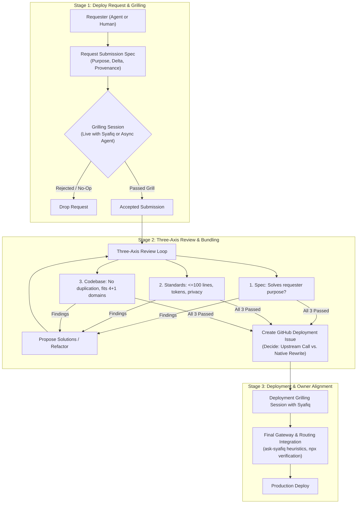
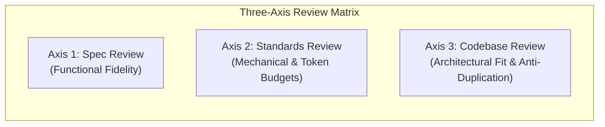

# Skill Ingestion & Deployment Workflow Specification

> [!IMPORTANT]
> **Core Objective**: Prevent prompt and skill rot while enabling continuous, high-taste ingestion of capabilities from external project repositories or upstream sources into `skay93m/skills`.

## 1. Architectural Overview

The Skill Ingestion & Deployment Workflow operates as a strict **Three-Stage Quality Funnel**. No skill enters the canonical skill tree without passing through request grilling, multi-proxy review, and owner alignment.




## 2. Stage 1: Deploy Request & Grilling

Every skill deployment begins with a structured request from either an autonomous agent working in another project or directly from the repository maintainer.

### 2.1 The Request Submission Artifact
The requester must supply a declarative submission answering four fundamental questions:

```markdown
### Skill Deployment Request

1. **Requester Purpose**:
   - What concrete user outcome or workflow friction does this skill resolve?
   - In what host environment will it operate (Claude, Codex, Antigravity)?

2. **The Matt Pocock Behavioral Delta**:
   - Why can't the frontier model execute this out-of-the-box using general reasoning?
   - What statutory constraints, taste rules, personal cadences, or repository invariants does it enforce?

3. **Domain Classification**:
   - Which of the 4+1 deep module domains does it target (`curate`, `code`, `tutor`, `setup`, or `style`)?
   - Should it be an encapsulated submodule or a standalone capability?

4. **Provenance & Source Integrity**:
   - Source repository URL, commit SHA, and license.
   - Author / creator attribution.
```

### 2.2 Grilling Modes

> [!TIP]
> Grilling eliminates speculative generality, prompt bloat, and redundant wrappers before any code is committed.

- **Mode A: Asynchronous Subagent Grilling**:
  - Used when an external project agent requests deployment.
  - The Skills Coordinator runs an adversarial interview against the requester agent.
  - Syafiq passes prompts or observes asynchronously.
  - Tests edge cases, token budgets, and verifies if the requester's stated problem is actually solved.
- **Mode B: Live Human Grilling**:
  - Used when Syafiq initiates a skill concept.
  - Interactive dialogue to sharpen boundaries, determine whether the skill passes the Matt Pocock Filter, and establish acceptance criteria.
- **Mode C: Hybrid Grilling**:
  - Subagent creates the initial draft; Syafiq conducts a final 5-minute stress test.

## 3. Stage 2: Three-Axis Review Loop & Ingestion Bundling

Once the request submission survives grilling, it enters an adversarial review loop across three distinct axes.



### 3.1 The Three Review Axes

1. **Axis 1: Specification Review**:
   - Does the implementation match the requester’s validated purpose?
   - Are edge cases handled safely?
   - Is speculative generality avoided (no unused parameters or hypothetical flags)?

2. **Axis 2: Standards & Policy Review**:
   - **Line Budget**: Entrypoint `SKILL.md` strictly $\le 100$ lines.
   - **Token Budget**: Total skill context footprint strictly $\le 700$ tokens.
   - **Reference Links (`S5`)**: Terminal references only; no daisy-chaining reference files (`A -> B -> C`).
   - **Privacy & Security**: Zero secrets, zero PII, zero internal machine paths.
   - **Provenance (`S6`)**: Frontmatter contains valid `origin`, `agent_involvement`, and `divergence`.

3. **Axis 3: Codebase & Architecture Alignment**:
   - **Anti-Duplication**: Does an existing deep module already handle this (`ask-syafiq`, `curate`, `code`, `tutor`, `setup`)?
   - **Encapsulation**: If a bundle contains multiple related skills (e.g. `msc-coach`), it must be encapsulated as a submodule under an action domain rather than polluting the root `skills/` namespace.

### 3.2 Propose & Loop
If any axis fails:
- The reviewing Skills Agent must not simply reject; it must propose concrete architectural refactorings or code solutions.
- The requester amends the submission.
- The loop repeats until all three proxy reviews achieve an explicit `PASS`.

### 3.3 Upstream Call vs. Native Rewrite Decision

Once approved, the Skills Agent creates a GitHub Deployment Issue and classifies the ingestion strategy:

| Ingestion Strategy | When to Choose | Implementation Pattern |
| :--- | :--- | :--- |
| **Upstream Delegation** | Upstream repository is well-maintained, standard-compliant, and focused (e.g., `mattpocock/skills`, `basic-memory-skills`). | Configure a thin proxy wrapper with clear provenance pointing to the upstream repository. |
| **Native Deep Rewrite** | Upstream is bloated ($>700$ tokens), unmaintained, violates repo standards, or contains proprietary assumptions. | Extract core logic, rewrite into our deep module structure, enforce $\le 100$ lines, and absorb natively. |

## 4. Stage 3: Deployment & Owner Alignment

The final stage ensures operational harmony with existing workflows and tools before merging to `main`.

### 4.1 Deployment Grilling with Syafiq
Before cutting a release or merging the pull request, the Skills Agent conducts a focused alignment session with Syafiq:
- **Routing & Discovery**:
  - How will `ask-syafiq` discover and route to this skill?
  - Does it need user invocation (`/ask-<domain>`) or model invocation?
  - How does it map to the GTD Project Detector / Reference-Action split?
- **Host Coexistence**:
  - Verifying compatibility across target runtimes (Claude, Codex, Antigravity).
  - Checking that no global home-directory side effects occur (adhering to Gate #89).

### 4.2 Automated Release Gates
Prior to deployment, the bundle must pass all 5 CI verification checks:
1. `python3 scripts/check-standard.py --base origin/main` (0 blocking findings).
2. `pytest` (100% passing across all unit and contract tests).
3. `tests/test_npx_packaging.py` (idempotent packaging verification).
4. Manifest and routing table synchronization.
5. Zero uncommitted changes in working tree.

## 5. Summary Lifecycle Checklist

- [ ] **Stage 1: Request & Grilling**
  - [ ] Requester submission spec completed (Purpose, Delta, Provenance).
  - [ ] Grilling completed (Live or Async Subagent).
- [ ] **Stage 2: Three-Axis Review Loop**
  - [ ] Spec Review passed (solves purpose, no bloat).
  - [ ] Standards Review passed ($\le 100$ lines, $\le 700$ tokens, S5, S6).
  - [ ] Codebase Alignment passed (no duplication, proper domain fit).
  - [ ] GitHub Deployment Issue created with Upstream vs. Rewrite decision.
- [ ] **Stage 3: Deployment & Alignment**
  - [ ] Alignment grilling with Syafiq completed (routing, GTD heuristics).
  - [ ] 5-point CI release gate passing.
  - [ ] Deployed to production.
