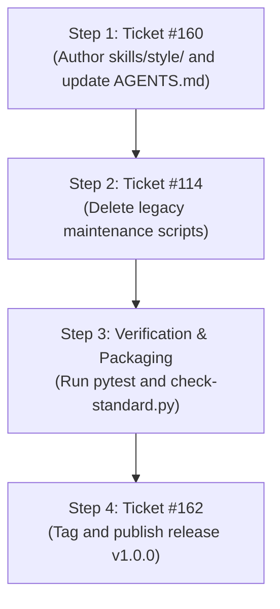

# Sprint 1: v1.0.0 Style & Agile Baseline (18/10/26)

> [!IMPORTANT]
> **Sprint Period**: 18 October 2026 (Single-Session Sprint)
> **Sprint Goal**: Deploy a focused, high-leverage production baseline that eliminates daily conversational friction and establishes the permanent native GitHub Agile workflow for all future agents.

## 1. Definition of Done (DoD)

Sprint 1 is formally complete when all four conditions are satisfied:
1. **Agile Workflow Codified**: `AGENTS.md` is refactored to establish native GitHub Milestones as Sprints, defining how specs, epics, and tickets operate.
2. **Style Skill Live**: `skills/style/` is live and compliant with all standard checks, enforcing British English spelling, banning em dashes, and banning horizontal dividers.
3. **Legacy Maintenance Retired**: Superseded report-only maintenance code and associated tests are removed via Issue #114 with safe fail-closed tombstones in place.
4. **v1.0.0 Production Release Cut**: Standard checks and tests pass with zero blocking findings, and release tag `v1.0.0` is published on GitHub.

## 2. Sprint 1 Ticket Backlog

The sprint contains three sequential tickets:

### Ticket A: Implement `skills/style/` and Refactor `AGENTS.md` (Issue #160)
- **Primary Deliverables**:
  - Author `skills/style/SKILL.md` (under 100 lines, under 700 tokens).
  - Create `skills/style/references/language-and-formatting.md` codifying:
    - British English spelling (prioritise, behaviour, synthesise, organise).
    - Absolute ban on em dashes (use commas, colons, or parentheses).
    - Absolute ban on horizontal dividers in conversational text and reviews.
    - Markdown table visual rules (one point per line).
  - Create `skills/style/templates/` for standard review and spec layouts.
  - Refactor `AGENTS.md` to document the Milestone = Sprint model and style compliance.
  - Author `manifests/style.yaml`.
- **Exit Gate**: `python3 scripts/check-standard.py` exits 0 with zero blocking findings.

### Ticket B: Retire Legacy Maintenance Code (Issue #114)
- **Primary Deliverables**:
  - Delete `scripts/knowledge_maintenance.py` and `tests/test_knowledge_maintenance.py`.
  - Mark `docs/specs/daily-knowledge-maintenance.md` as superseded.
  - Ensure legacy skill entry points route to fail-closed safe tombstones.
- **Exit Gate**: Test suite passes cleanly without missing module errors.

### Ticket C: Release Verification and v1.0.0 Tag (Issue #162)
- **Primary Deliverables**:
  - Run full test suite and standard checks.
  - Verify clean working tree on `main` (satisfying Gate #89).
  - Draft release notes in `docs/releases/v1.0.0.md`.
  - Push release tag `v1.0.0` to GitHub.
- **Exit Gate**: Release published and verified on GitHub.

## 3. Execution Timeline for Today

## 4. Deferred to Sprint 2 (v1.1.0)

All broader architectural expansions are safely deferred to subsequent sprints:
- Scaffold the remaining action domains (`curate`, `code`, `tutor`, `setup`).
- Master gateway `ask-syafiq` GTD diagnostic routing.
- External contributor ingestion workflow (Issue #158).
- Host wrapper scripts (`~/.local/bin/skills`).
