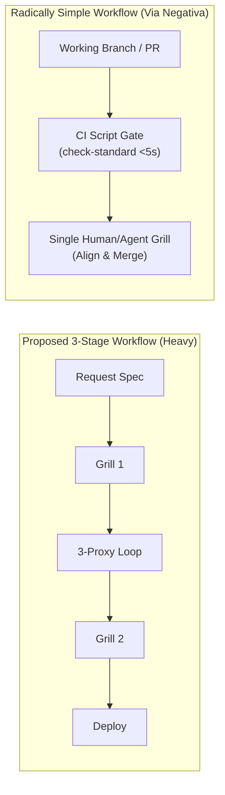
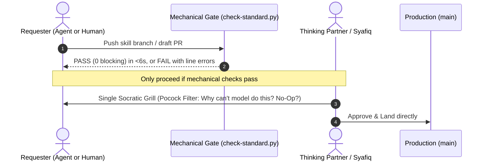

# Thinking Partner Sparring: Is This the Simplest Workflow There Can Be?

> [!NOTE]
> **Dialectical Focus**: Applying the Oxford Socratic method and core mental models (*Inversion*, *Via Negativa*, *Theory of Constraints*, *Reversibility / Two-Way Doors*, *First Principles*) to stress-test the proposed 3-stage Skill Deployment Workflow.

---

## 1. The Socratic Challenge: Inverting the Funnel

If we invert the proposition and ask: **"How would we design a process guaranteed to create friction, stall deployments, and burn agent tokens?"**

We would:
1. Demand a bespoke submission document before anything is written.
2. Require a multi-turn grilling session upfront (Stage 1).
3. Require three separate agent proxies to review and loop repeatedly (Stage 2).
4. Demand *a second grilling session* with the owner at deployment time (Stage 3).

---

## 2. Mental Model Evaluation

### A. Reversibility Test (Type 1 vs. Type 2 Doors)
- **The Principle**: One-way doors (irreversible) require intense deliberation; two-way doors (reversible) should be walked through quickly.
- **The Reality**: Deploying a skill into git is **100% reversible (Type 2)**. A single `git revert` or `rm -rf skills/<name>` undoes it completely.
- **Diagnosis**: The 3-stage workflow treats a two-way door like a nuclear launch sequence.

---

### B. Theory of Constraints (Where is the Real Bottleneck?)
- **The Principle**: A system's throughput is limited by its single scarcest resource.
- **The Reality**: The scarcest resource in this repository is **Syafiq's cognitive attention**.
- **Diagnosis**: Having Syafiq participate in **Grilling 1 (Stage 1)** AND **Grilling 2 (Stage 3)** makes the human the permanent blocking bottleneck.

---

### C. Via Negativa (Subtractive Simplicity)
- **The Principle**: Perfection is achieved not when there is nothing more to add, but when there is nothing left to take away.
- **What Can Be Subtracted**:
  1. *Delete Grilling 1*: Don't grill on an abstract proposal. Grill on a concrete working prototype or diff.
  2. *Delete Manual Proxy Reviews*: Let `python3 scripts/check-standard.py` and `pytest` do 90% of the review mechanically in <6 seconds. Agents should only review what machines cannot check (taste, prompt clarity).
  3. *Collapse into a Single Stage-Gate*: Instead of 3 stages, use **2 clean phases: Mechanical Verification $\to$ Single Alignment Grill**.

---

### D. First Principles Decomposition
What is fundamentally true about a skill?
- It is a directory with a `SKILL.md` (≤100 lines, ≤700 tokens) and optional references.
- It either solves a problem better than the base model, or it is prompt bloat.
- Therefore, the **only two questions that matter** are:
  1. Does it pass the mechanical linter (`check-standard.py`)?
  2. Does it pass the Matt Pocock filter ("Why can't the model do this out-of-the-box?")?

---

## 3. Comparative Architecture Matrix

| Dimension | The Proposed 3-Stage Funnel | The Radically Simple Funnel (Thinking-Partner Proposal) |
| :--- | :--- | :--- |
| **Stages** | 3 distinct stages (Request $\to$ Review $\to$ Deploy) | **1 unified pull request flow with 2 checks** |
| **Grilling Sessions** | 2 sessions (Stage 1 upfront + Stage 3 deploy) | **1 single Socratic sparring session on the actual PR** |
| **Review Method** | 3 conversational LLM proxies looping | **Mechanical CLI preflight (<6s) + 1 Adversarial Spec Reviewer** |
| **Artifacts Produced** | Request Spec + Deployment Issue + PR | **The PR itself (containing frontmatter provenance)** |
| **Friction on External Agents** | Heavy: must author spec, await grill, await review | **Light: agent submits branch; CI checks immediately; human grills once** |

---

## 4. The Radically Simple Proposal

### The 2 Hard Rules of the Simple Workflow:
1. **Rule 1 (The Machine Filters First)**: No human or agent engages in conversation until `python3 scripts/check-standard.py` exits 0. This instantly filters 80% of bad submissions with zero human cost.
2. **Rule 2 (One Sparring Session Only)**: There is exactly one sparring session, conducted on the concrete draft PR, testing the Matt Pocock Delta and domain routing.
