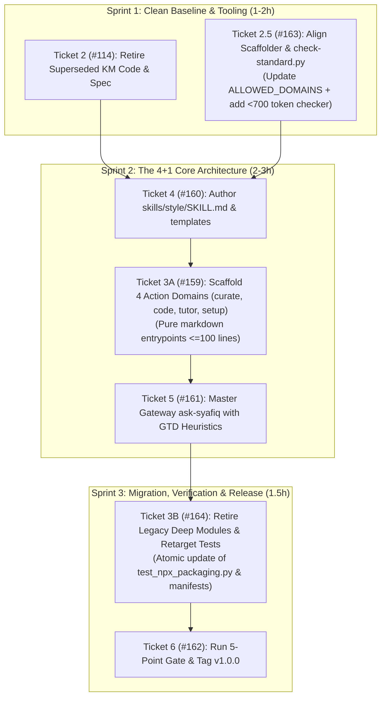

# v1.0.0 Minimal Production Deploy: Streamlined 3-Sprint Plan

> [!IMPORTANT]
> **Baseline Reference**: Decomposed directly from [Spec #157](https://github.com/skay93m/skills/issues/157) (`docs/specs/v1-production-readiness.md`), [ADR 0002](docs/adr/0002-four-domain-gateway-and-style-architecture.md), and hardened via the Adversarial Milestone Review ([`docs/proposals/milestone-adversarial-review.md`](docs/proposals/milestone-adversarial-review.md)).  
> **Milestone**: `v1.0.0: Minimal Production Deploy` (Milestone #3).  
> **Topology Invariant**: Root `skills/` exposes **6 active domains + 26 passive safe tombstones** (total 32 directories).

---

## 1. Streamlined 3-Sprint Execution Graph

---

## 2. Sprint Breakdown & Ticket Mapping

### Sprint 1: Clean Baseline & Tooling Alignment
1. **[Issue #114](https://github.com/skay93m/skills/issues/114): Ticket 2 — Retire Superseded Report-Only Maintenance Code & Spec**
   - Delete `scripts/knowledge_maintenance.py` and `tests/test_knowledge_maintenance.py`.
   - Formally mark `docs/specs/daily-knowledge-maintenance.md` as superseded.
   - Deploy fail-closed tombstones redirecting to `curate` and `ask-syafiq`.
2. **[Issue #163](https://github.com/skay93m/skills/issues/163): Ticket 2.5 — Align Scaffolder `ALLOWED_DOMAINS` & Token Ceiling**
   - Update `ALLOWED_DOMAINS` in `scripts/new-skill.py` and `docs/standards/skill-manifest.md` to `("curate", "code", "tutor", "setup", "style", "general")`.
   - Permit `disable-model-invocation: false` for `ask-syafiq` and `style`.
   - Implement `< 700` token estimation in `scripts/check-standard.py`.

---

### Sprint 2: Core 4+1 Architecture
3. **[Issue #160](https://github.com/skay93m/skills/issues/160): Ticket 4 — Ambient Style Foundation Module (`style`)**
   - Author `skills/style/SKILL.md` (≤100 lines) with formatting rubrics, artifact layouts, and ubiquitous language definitions.
   - Configure as ambient companion peer-dependency (`disable-model-invocation: true`).
4. **[Issue #159](https://github.com/skay93m/skills/issues/159): Ticket 3A — Scaffold 4 Action Domain Deep Modules**
   - Author entrypoint `SKILL.md` (≤100 lines) for `curate`, `code`, `tutor`, `setup`.
   - Configure upstream delegation to `basicmachines-co/basic-memory-skills` and `mattpocock/skills`.
   - Author corresponding manifests in `manifests/`.
5. **[Issue #161](https://github.com/skay93m/skills/issues/161): Ticket 5 — Master Gateway `ask-syafiq` with GTD Heuristics**
   - Sole model-invocable skill (`disable-model-invocation: false`).
   - Implement Project Detector (>1 physical step) and Reference vs. Action split.
   - Wire routing table to the 4 action domains and companion `style`.

---

### Sprint 3: Migration, Verification & Production Cut
6. **[Issue #164](https://github.com/skay93m/skills/issues/164): Ticket 3B — Retire Legacy Deep Modules & Retarget Test Suites**
   - Cleanly retire the 6 historical deep modules (`wiki-ops`, `autonomous-scrum`, `agent-ecosystem`, `academic-scholar`, `personal-cadence`, `thinking-partner`).
   - Atomically retarget test expectations in `test_deep_modules_core.py`, `test_deep_modules_scholarship_cadence_cognition.py`, `test_ask_syafiq.py`, and `test_npx_packaging.py` (32 total directories: 6 active + 26 tombstones).
7. **[Issue #162](https://github.com/skay93m/skills/issues/162): Ticket 6 — Verify 5-Point CI Release Gate & Tag v1.0.0**
   - Run full test suite, standard checks, and packaging dry-run.
   - Verify clean working tree (Gate #89).
   - Publish `v1.0.0` release tag and release documentation.

---

## 3. Decoupled / Post-v1.0.0 Backlog
- **[Issue #158](https://github.com/skay93m/skills/issues/158)**: Semantic analysis and hardening of external contributor ingestion workflow — moved to Milestone 4 (`v1.1.0: Operational Enhancements`).
