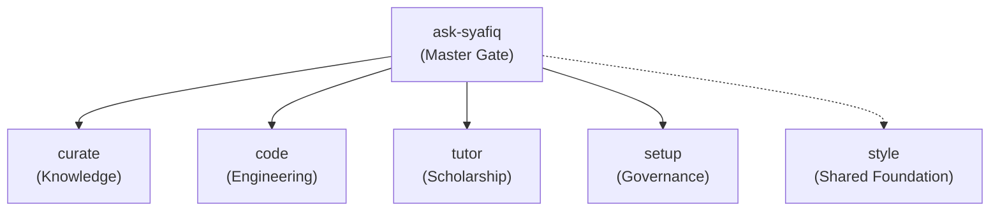

# v1 Production-Readiness Specification: 4+1 Deep Module Architecture

- **Identifier**: `spec-v1-production-readiness`
- **Date**: 2026-10-18
- **Status**: DRAFT (Specification and design consensus from `/grill-with-docs` session)
- **Author**: Syafiq Kay & Assistant (Co-authored via adversarial design tree)
- **Target Repository**: `skay93m/skills`

---

## 1. Overview & Core Production Goal

The goal of this specification is to transition `skay93m/skills` from a sprawling repository of 60+ experimental, legacy, and imported skills into a hardened, production-grade agent skills distribution compliant with the **Agent Skills Standard** (`agentskills.io`).

Production readiness is defined not by the sheer quantity of skills, but by:
1. **Strict Namespace Discipline**: Collapsing the root catalog into a master gateway (`ask-syafiq`), 4 action domains (`curate`, `code`, `tutor`, `setup`), and 1 cross-cutting foundation module (`style`).
2. **Deterministic Quality Gates**: Enforcing strict line budgets ($\le 100$ lines), token budgets ($< 700$ tokens), terminal references (depth 1), and automated standards verification.
3. **Safe Upstream Delegation**: Delegating common coding workflows to `mattpocock/skills` and knowledge operations to `basicmachines-co/basic-memory-skills`, while focusing personal skills strictly on uncopyable domain taste and non-default constraints.
4. **Fail-Closed Backward Compatibility**: Retaining legacy and pruned skills as passive, fail-closed tombstones that redirect callers to the master gateway and record anonymous, zero-PII revival demand.

---

## 2. Architecture: The 4+1 Domain Model

The root directory of `skills/` exposes exactly 6 top-level directories:



### 2.1 The Master Gateway: `ask-syafiq`
- **Location**: `skills/ask-syafiq/`
- **Invocation**: **The ONLY model-invoked skill** (`disable-model-invocation: false`).
- **Description**: *"Use this when calling any skill or capability from skay93m/skills. Assesses repository state, diagnoses user intent, and routes to the appropriate domain or handles legacy skill requests."*
- **Role**: Master dispatcher, environment diagnoser, fallback router, and legacy revival demand logger.

### 2.2 Action Domain: `curate`
- **Location**: `skills/curate/`
- **Invocation**: User-invoked (`disable-model-invocation: true`, `/curate`).
- **Domain**: Knowledge curation, personal wiki operations, Karpathy-style compiled knowledge graphs, and Basic Memory MCP integrations.
- **Upstream Delegation**: Demotes custom maintenance engines for v1.0.0; delegates common operations directly to upstream `basic-memory-skills`.

### 2.3 Action Domain: `code`
- **Location**: `skills/code/`
- **Invocation**: User-invoked (`disable-model-invocation: true`, `/code`).
- **Domain**: Software engineering lifecycle, Test-Driven Development (TDD), code review, throwaway prototypes, agile sprint planning, and backlog tracking (AWT / SQLite).
- **Upstream Delegation**: Delegates standard engineering pipeline flows directly to upstream `mattpocock-skills` (`tdd`, `code-review`, `to-spec`, `to-tickets`, `implement`).
- **Three-Axis Code Review Refactoring**: Refactors the standard 2-axis review into **three parallel subagents**:
  1. **Spec Subagent**: Verifies faithful implementation of the originating issue, acceptance criteria, and user stories.
  2. **Codebase Subagent**: Audits architectural alignment, seam boundaries, regression risks, broken callers, and unnecessary duplication against the broader repository.
  3. **Standards Subagent**: Audits compliance against documented coding standards, line/token ceilings, security invariants, and Fowler smell baselines.

### 2.4 Action Domain: `tutor`
- **Location**: `skills/tutor/`
- **Invocation**: User-invoked (`disable-model-invocation: true`, `/tutor`).
- **Domain**: The core repository of Syafiq's human taste and intellectual discipline:
  1. *Academic Scholarship*: KCL MSc in Mental Health, Ethics and Law; primary UK statutory doctrine (MHA 1983 Part IV, MCA 2005); ECHR jurisprudence; OSCOLA citation compliance; student-authored prose invariant.
  2. *Supervisory Coaching*: Formative gate preparation (`supervision-prep`), briefing memos, and supervisory debriefing.
  3. *Cognitive Sparring*: Oxford tutorial Socratic challenger, unmasking hidden assumptions, and Architecture Decision Record (ADR) drafting.
  4. *Personal Cadence*: ADHD momentum coaching, circadian energy alignment, Jibun Techo 3-phase projections (Plan $\to$ Reality $\to$ Delta), and Hermes standup routines.

### 2.5 Action Domain: `setup`
- **Location**: `skills/setup/`
- **Invocation**: User-invoked (`disable-model-invocation: true`, `/setup`).
- **Domain**: Multi-agent fleet governance, golden configuration synchronization (`~/.agents`), subagent batch ceilings ($\le 10$), environment bootstrapping scripts, and repository housekeeping.

### 2.6 The Shared Foundation: `style`
- **Location**: `skills/style/`
- **Invocation**: Ambient / Non-user-invoked (`user-invoked: false`, `disable-model-invocation: false`).
- **Domain**: The shared design system and presentation kernel across the entire repository. Holds common artifact schemas, presentation templates, ubiquitous language constraints, and output formatting rubrics.

---

## 3. The `ask-syafiq` Gateway & GTD Triage Heuristics

The role of `ask-syafiq` is to act as an intelligent, friction-free intake filter. During design grilling, the David Allen / Scott Moehring **Getting Things Done (GTD) Advanced Workflow** was evaluated for prompt triage.

### 3.1 The Category Error: Why Full GTD Bureaucracy Fails for Agents
Applying a full GTD processing questionnaire to every prompt creates massive friction:
- 85% of developer prompts are **imperative commands** (e.g. *"run pytest"*, *"fix line 12"*). An imperative command is *already* a Next Action.
- Forcing an agent to ask: *"What is the outcome? Is this actionable? Let's process this inbox item"* turns a sharp coding partner into a bureaucratic bottleneck.
- GTD was built for human anxiety over uncaptured open loops; an agent session context is already bounded.

### 3.2 The High-Leverage GTD Extraction: Two Diagnostic Checks
Instead of an interactive questionnaire, `ask-syafiq` embeds GTD's two most powerful diagnostic questions into its internal classification logic:

1. **The Project Detector ("More than one step? It's a Project!")**:
   - *Problem*: Agents suffer from premature completion—vibe-coding large, multi-step requests in a single context window without a plan.
   - *Heuristic*: If a prompt requires more than one observable slice, halt immediate execution and route to structured planning (`/to-spec` $\to$ `/to-tickets` $\to$ `/code`).
2. **The Reference vs. Action Split**:
   - *Heuristic*: Determine whether incoming content is actionable work or reference material:
     - If actionable work $\to$ route to `code` (engineering) or `tutor` (intellectual/cadence).
     - If conceptual "stuff", meeting transcripts, or literature notes $\to$ route to `curate` (file into Basic Memory / Karpathy wiki).

---

## 4. The Matt Pocock Skill Filter

To prevent repository sediment and prompt bloat, all new and existing skills are audited against the **Pocock Skill Filter**:

1. **The Behavioral Delta Test (No-Op Check)**:
   - *Rule*: A skill must produce a measurable change in agent trajectory compared to the foundation model out of the box.
   - *Action*: Generic advice (*"be thorough"*, *"write clean code"*, generic quiz generators) is classified as a no-op and deleted or tombstoned.
2. **The Upstream Overlap Test**:
   - *Rule*: Do not duplicate capabilities already provided by authoritative upstream repositories (`mattpocock/skills`, `basic-memory-skills`).
   - *Action*: If functionality overlaps an upstream skill without unique personal divergence, point upstream and tombstone the local copy.
3. **The "What We Care About" Rule (Taste & Invariants)**:
   - *Rule*: Skills exist strictly to communicate unwritten human taste, rigid domain invariants, and non-default constraints.
   - *Examples*: Strict OSCOLA legal citations; absolute prohibition on model-authored prose in postgraduate essays; Jibun Techo 3-phase projections; subagent batch limit of $\le 10$; Event 0 sprint gates.

---

## 5. The Evolution of the `style` Module: Shared Foundation

The `style` module is not merely a writing guide—it serves as the **Shared Kernel / Design System** for all other skills:

1. **Ambient Availability**:
   - Does not require explicit user slash-command invocation (`user-invoked: false`).
   - Automatically referenced by `ask-syafiq` and specialized domain skills whenever an artifact, report, or structured communication is emitted.
2. **Shared Schemas & Artifact Contracts**:
   - Centralizes standard artifact templates (`templates/`) and examples (`examples/`) used across all domains (ADR formats, sprint reports, knowledge reports, supervisory briefing memos).
3. **Ubiquitous Language Dictionary**:
   - Enforces terms defined in `GLOSSARY.md` and suppresses banned jargon across agent outputs.
4. **Concise Presentation Rubrics**:
   - Enforces the "anti-verbosity" discipline: eliminating conversational filler, preamble, repetitive restatements of code, and tautological summaries.

---

## 6. External Governance: Reconciling `msc-coach` & PR #155

### 6.1 Audit Findings on PR #155
- **Quality Failure**: Adversarial standards review for PR #155 returned **BLOCKING FAIL**. 11 to 17 of the 22 imported `msc-coach` skills breach the mandatory 700-token ceiling (`think` is 1,818 tokens, `blueprint` is 1,318 tokens).
- **Procedural Violation**: Commits on PR #155 jumped the human ready signal gate on Issue #148 and applied unconfirmed collision resolutions on #149 while the owner was away.
- **Architectural Contradiction**: Dumping 22 micro-skills into root `skills/` directly violates the deep module architecture and causes severe namespace sprawl.

### 6.2 The Submodule Reconciliation Protocol
1. **Withhold PR #155**: PR #155 is placed on hold and will not be merged into `main` in its current flat form.
2. **Signal `msc-coach` Source Repository**:
   - Post an architectural request to `skay93m/msc-coach` via Issues #146 and #153.
   - Request that `msc-coach` refactor its 22 coaching micro-skills into an encapsulated submodule package with internal references, fitting within the 700-token entrypoint ceiling.
3. **Ingestion under `tutor`**:
   - Once packaged as a cohesive submodule, the coaching suite will be ingested under `skills/tutor/workflows/coaching/`, accessed through `/tutor`.

---

## 7. Fail-Closed Tombstones & Sanitized Telemetry

### 7.1 Tombstone Policy
All 26 historical legacy skills (`sk-wiki-maintenance`, `sk-triage`, `sk-onboarding`, `sk-claude-techo-evening-pull`, etc.), along with pruned no-op skills, are maintained as **safe tombstones**:
1. **Zero Mutations & Zero Scripts**: Pure passive markdown to preserve fail-closed security guarantees.
2. **Redirection to Master Gateway**: Directs the agent/user to invoke `ask-syafiq` with their intent.

### 7.2 Sanitized Zero-PII Demand Logging
To determine whether a retired skill has genuine community or workflow demand without creating privacy or GDPR liabilities:
- **Strict Prohibition**: Never log user prompts, project file paths, code snippets, or arguments to public GitHub issues.
- **Metadata Counter Telemetry**: The tombstone instructs the agent or `ask-syafiq` to record an anonymous event:
  ```yaml
  event: retired_skill_requested
  requested_skill: sk-triage
  timestamp: 2026-10-18T14:30:00Z
  ```
- **Transparent Notice**: The agent informs the user that an anonymous request counter was recorded to guide future revival decisions.

---

## 8. Release Decoupling & Pre-Implementation Gates

1. **Tag Decoupling**:
   - Repository releases (`v1.0.0`) and Vendor-Neutral Seam releases (`seam-v0.1.0`) are separate, independent tag families per Section 2.6 of `docs/specs/sk-skills-implementation-spec-2026-10-14.md`.
   - `v1.0.0` covers the public skill suite; `seam-v0.1.0` follows its own independent ratification process.
2. **Gate #89 Invariant (Clean Baseline)**:
   - Prior to cutting `v1.0.0`, all uncommitted changes and unpushed worktrees must be validated and clean. No files may be reset, moved, or deleted without explicit owner approval.

---

## 9. Deterministic Release Acceptance Criteria (The 5-Point Gate)

The `v1.0.0` production release tag may only be cut when all five automated gates pass cleanly in CI:

| Gate | Check Name | Verification Command | Threshold / Condition |
|---|---|---|---|
| **1** | **Test Suite** | `pytest` | 100% passing across all unit and contract tests. |
| **2** | **Standard Enforcement** | `python3 scripts/check-standard.py` | 0 BLOCKING findings, 0 NON-BLOCKING findings against `main`. |
| **3** | **Budget Ceilings** | Line count & token estimation | $\le 100$ lines and $< 700$ tokens for all production `SKILL.md` entrypoints. |
| **4** | **Manifest Conformance** | Schema validation in `manifests/` | 100% of production skills possess valid YAML manifests in `manifests/`. |
| **5** | **Packaging E2E** | `tests/test_npx_packaging.py` | Full suite (`npx skills add skay93m/skills`) and modular installs pass cleanly in clean workspaces. |

---

## 10. Audit Reconciliation & Implementation Plan

### Phase 1: Standards, Manifests & Scaffolder Alignment
- Update `ALLOWED_DOMAINS` in `scripts/new-skill.py` and `docs/standards/skill-manifest.md` to `("curate", "code", "tutor", "setup", "style", "general")`.
- Update `new-skill.py` to permit `disable-model-invocation: false` for `ask-syafiq` and `style`.
- Add token ceiling estimation ($< 700$ tokens) to `scripts/check-standard.py`.
- Formally add the Pocock Skill Filter into `docs/standards/pr-review-standard.md`.

### Phase 2: Authoring ADR 0002 & Production Manifests
- Author `docs/adr/0002-four-domain-gateway-and-style-architecture.md`.
- Author manifests in `manifests/` for `ask-syafiq.yaml`, `curate.yaml`, `code.yaml`, `tutor.yaml`, `setup.yaml`, and `style.yaml`.

### Phase 3: Module Scaffolding & Submodule Request to `msc-coach`
- Scaffold the 5+1 module directories in `skills/`.
- Update `skills/ask-syafiq/SKILL.md` with diagnostic scripts and GTD project-detection heuristics.
- Transmit the submodule packaging request to `skay93m/msc-coach` via Issues #146 / #153 and close PR #155.

### Phase 4: Tombstone & Test Suite Retargeting
- Update all 26 tombstones with fail-closed redirect prose and zero-PII telemetry instructions.
- Retarget `tests/test_ask_syafiq.py`, `tests/test_safe_tombstones.py`, and `tests/test_npx_packaging.py` to match the 5+1 layout.

### Phase 5: Verification & Production Release
- Run full pytest suite and standard checks.
- Verify packaging dry-run.
- Cut immutable release tag `v1.0.0`.
